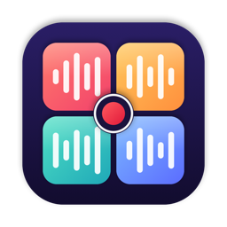
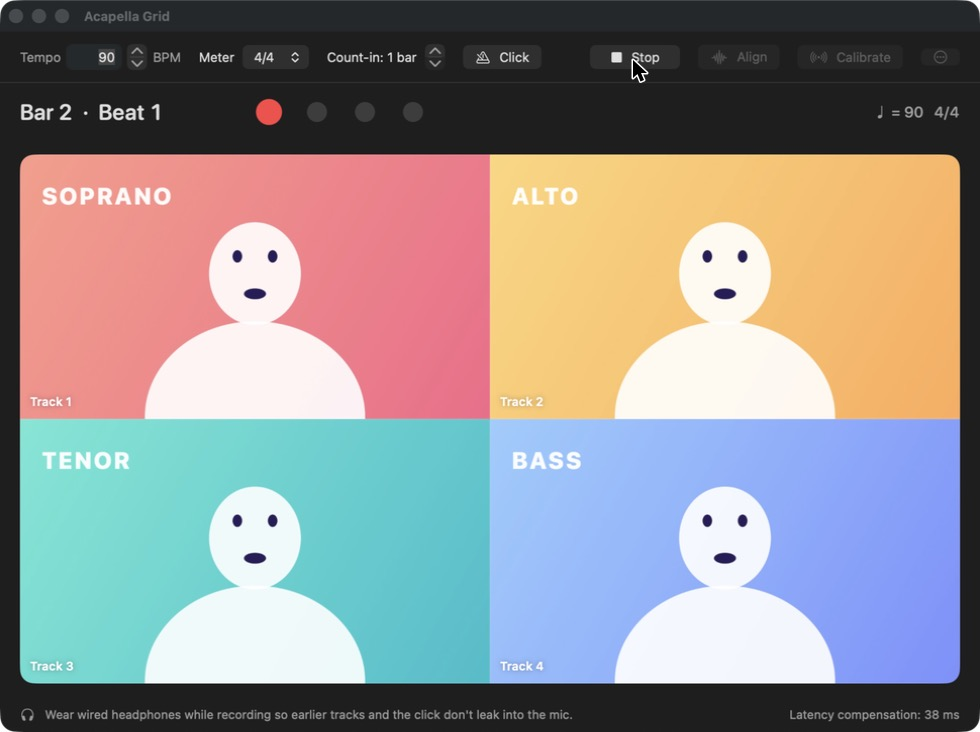
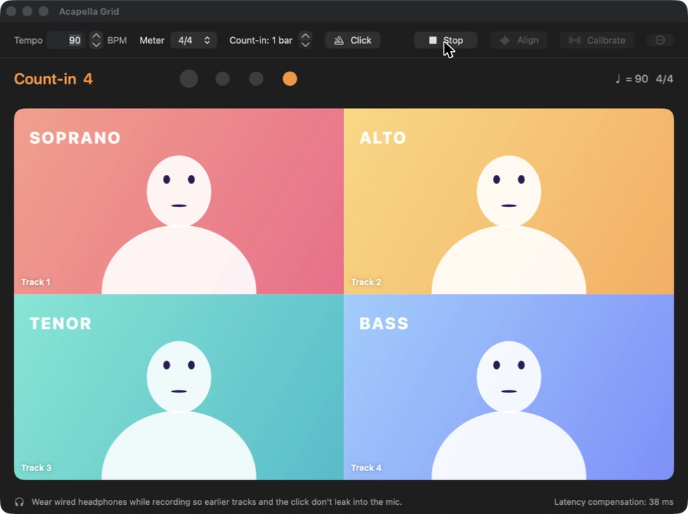
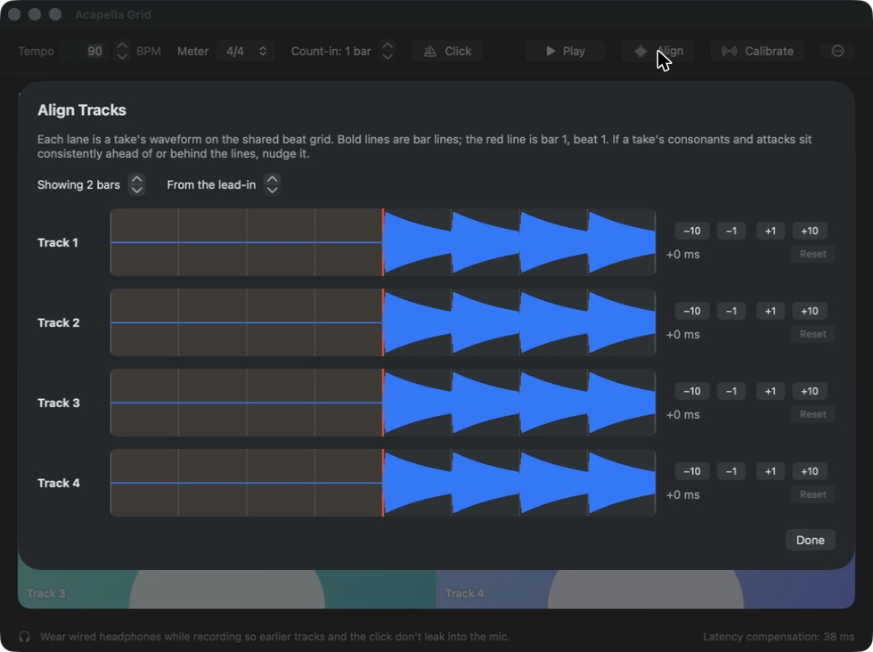
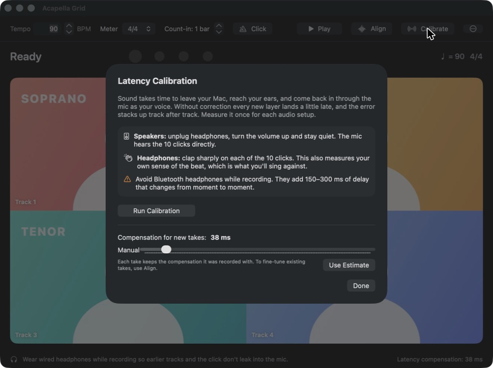

<div align="center">



# Acapella Grid

**Record yourself singing every part of an a cappella song in a split-screen video, and keep all four parts in sync.**

[](#install)
[](#build-from-source)
[](https://github.com/ThCyber/AcapellaGrid/releases/latest)
[](LICENSE)

English · [简体中文](README.zh-CN.md)



</div>

## Why

Recording a one-person a cappella video sounds simple: record the soprano, then the alto over it, and so on. In practice every layer lands a little late. Your Mac needs time to play the backing tracks to your ears, and your voice needs time to get back in through the mic. After four layers the bass is noticeably behind the soprano.

Acapella Grid fixes this on two fronts:

- **For you:** an audible click plus a **visual metronome**, which shows a count-in, a beat strip and a border that flashes on every beat, so you can see the beat as well as hear it.
- **For the machine:** a shared clock, measured latency compensation and single-timeline playback. These remove the timing errors that singing on the beat can't fix.

## Features

- 🎛 **2×2 grid.** Click an empty cell to record that part while the other parts play along.
- 🥁 **Visual + audible metronome.** Adjustable tempo, meter (2/4–7/4) and count-in, with an accented downbeat.
- 🎯 **Latency calibration.** Measures your setup's round-trip delay in about 5 seconds.
- 🎼 **Pickups preserved.** The bar before bar 1 is recorded too, so notes before the downbeat aren't cut.
- 〰️ **Align view.** Shows every take's waveform on a shared beat grid, with ±1 / ±10 ms nudges.
- 🔇 **Per-track controls.** Re-record, mute or delete any cell.
- 📼 **Export.** Saves a 1080p MP4 of the full grid, identical to what you hear in the app.

| Count-in before a take | Align view | Latency calibration |
|:--:|:--:|:--:|
|  |  |  |

> Screenshots use the cartoon demo project generated by [`Tools/make_demo.swift`](Tools/make_demo.swift).

## Install

1. Download **`AcapellaGrid.zip`** from the [latest release](https://github.com/ThCyber/AcapellaGrid/releases/latest) and unzip it.
2. Drag **AcapellaGrid.app** into your **Applications** folder.
3. The app is not notarized by Apple, so the first launch needs one extra step. Choose either option:
   - Right-click the app → **Open** → **Open**, or
   - run this once in Terminal:
     ```bash
     xattr -dr com.apple.quarantine /Applications/AcapellaGrid.app
     ```
4. Allow **Camera** and **Microphone** access when asked. If you said no by mistake, turn it back on in *System Settings → Privacy & Security*.

The app runs natively on both Apple Silicon and Intel Macs running macOS 14 Sonoma or later.

## Tutorial

### 1. Before you start: headphones and calibration

**Wear wired headphones while recording.** If the backing tracks or the click come out of the speakers, the mic records them too. Avoid Bluetooth headphones: they add 150–300 ms of delay that keeps changing, and no fixed correction can fix that.

Then click **Calibrate** in the toolbar. Do this once for each audio setup, and again whenever you switch headphones or audio interface.

| Your setup | What to do |
|---|---|
| Speakers | Unplug headphones, turn the volume up and stay quiet. Click **Run Calibration**: the mic hears the 10 clicks directly. |
| Headphones | Click **Run Calibration** and **clap sharply on each of the 10 clicks**. This also measures your own sense of the beat, which is what you'll sing against. |

The result looks like *"Measured 38 ms from 10 of 10 clicks · Spread ±2 ms"*. If the spread is above about 15 ms the measurement was noisy, so run it again. You can also set the value by hand with the **Manual** slider. The value in use is always shown at the bottom right of the main window.

### 2. Set up the song

In the toolbar:

- **Tempo:** type a BPM or use the arrows.
- **Meter:** beats per bar (2/4 to 7/4).
- **Count-in:** how many bars of clicks you hear before recording starts (1–4).
- **Click:** whether the click plays while recording and/or during playback, and how loud it is.

> ⚠️ Set the tempo and meter **before** recording the first part. Changing them afterwards moves the beat grid away from the takes you've already recorded.

### 3. Record the first part

1. Click an empty cell, e.g. **Track 1**.
2. The cell switches to your camera and the **count-in** starts: big numbers **1 2 3 4** and an orange flashing border.
3. The **last count-in bar is already being recorded** (the cell says *"Get ready — pickups are recorded"*). Sing any pickup notes here.
4. At bar 1 the badge changes to **● REC**, the border turns red, and the strip above the grid shows *Bar · Beat*. Watch the big dot on beat 1 of every bar.
5. When you're done, **click the cell again or press Space**.

Stopping during the count-in throws the take away.

### 4. Layer the other parts

Click the next empty cell. Every recorded part now plays along while you sing, and the click continues on the same grid. Repeat until all four cells are filled.

### 5. Play back

Press **Play** (or **Space**). All parts play from a single timeline. Each filled cell flashes on the beat so you can check the timing by eye.

### 6. Fine-tune with Align (optional)

Open **Align** to see every take's waveform on a shared beat grid:

- Thin lines are beats, bold lines are bar lines, and the **red line** is bar 1, beat 1.
- If one part's consonants consistently sit ahead of or behind the lines, nudge it with **−10 / −1 / +1 / +10 ms**. **Reset** undoes the nudge.
- Use the steppers to zoom (how many bars are shown) and move along the song.

The current nudge also appears in the corner of that cell, e.g. `+6 ms`.

### 7. Manage tracks

Hover over a filled cell to see its buttons:

| Button | Action |
|:--:|---|
| ↺ | Re-record this part (the old take is replaced when the new one finishes) |
| 🔈 | Mute / unmute |
| 🗑 | Delete the take (asks for confirmation) |

### 8. Export

Click **⋯ → Export Grid Video…** and pick a location. You get a 1920×1080 MP4 of the full grid with all unmuted parts mixed. The finished file is shown in Finder.

### 9. Where your files live

Takes are saved automatically in `~/Movies/AcapellaGrid/Current Project/`. **⋯ → Show Project Folder** opens it, and **⋯ → Clear All Tracks** starts a new song. **⋯ → Mirror Video** flips the picture horizontally, which is on by default because it feels like a mirror.

## Troubleshooting

| Problem | Fix |
|---|---|
| Every new part sounds slightly late | Run **Calibrate** again, with your current headphones plugged in. |
| One part is consistently off | Use **Align** and nudge only that track. |
| Earlier parts are audible in later takes | You're recording with speakers. Switch to headphones. |
| "Camera and microphone access is needed" | *System Settings → Privacy & Security → Camera / Microphone* → enable AcapellaGrid. |
| macOS says the app "can't be opened" | See step 3 of [Install](#install). |

## How the sync works

```
 count-in clicks …  │ lead-in bar  │  bar 1  │  bar 2  │ …
                    ▲ timeline 0   ▲ song start (beat 0)
                    │
     recorder file time 0 ═ backing-track time 0 ═ lead-in click
     all scheduled at the same future mach host time
```

1. **One clock.** The metronome (`AVAudioEngine`), the backing tracks (`AVPlayer.setRate(_:time:atHostTime:)`) and the recorder (`AVCaptureSession` → `AVAssetWriter.startSession(atSourceTime:)`) are all scheduled against the mach host clock, at a time ~350 ms in the future. Nothing starts at "now", so the time each component takes to start up doesn't matter.
2. **Round-trip latency compensation.** Calibration schedules clicks at known host times, finds their onsets in the mic's sample buffers (which use the same clock), and takes the median delay. Each take stores the compensation it was recorded with, and the take is shifted earlier by that amount.
3. **One composition.** All takes are laid onto a single `AVMutableComposition` with an `AVVideoComposition` that draws the 2×2 grid. Playback uses one player, so the parts can't drift apart. Export renders the same composition.
4. **Visual metronome.** Driven by the same host-time position, offset by the output device latency so the flash lines up with the click you hear.

## Build from source

Requirements: Xcode 16 or later (the project uses folder-synchronized groups) and macOS 14+.

```bash
git clone https://github.com/ThCyber/AcapellaGrid.git
cd AcapellaGrid
open AcapellaGrid.xcodeproj   # then press ⌘R
```

Or build from the command line:

```bash
xcodebuild -project AcapellaGrid.xcodeproj -scheme AcapellaGrid -configuration Release -derivedDataPath build build
```

Handy extras:

- `swift Tools/make_icon.swift icon.png` renders the app icon.
- `swift Tools/make_demo.swift ~/Desktop/demo` generates the cartoon demo project. Open it with
  `open -n AcapellaGrid.app --args -ProjectFolder ~/Desktop/demo`.

### Project layout

```
AcapellaGrid/
├── Transport.swift           # orchestrates record / play / calibrate on one host-time timeline
├── Metronome.swift           # AVAudioEngine click track scheduled at absolute host times
├── CaptureRecorder.swift     # camera + mic → AVAssetWriter, starting at an exact host time
├── CompositionBuilder.swift  # lays takes on one timeline, renders the 2×2 grid
├── LatencyCalibration.swift  # click-onset detection for round-trip latency
├── Project.swift             # settings + tracks, saved as project.json
├── HostTime.swift            # mach host-time helpers
└── Views/                    # SwiftUI: grid, beat strip, Align, Calibrate
```

## License

[MIT](LICENSE) © 2026 samuelcai
